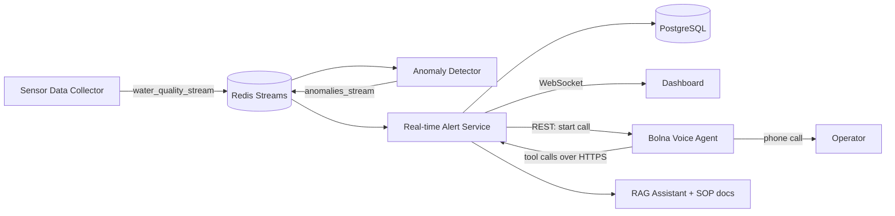
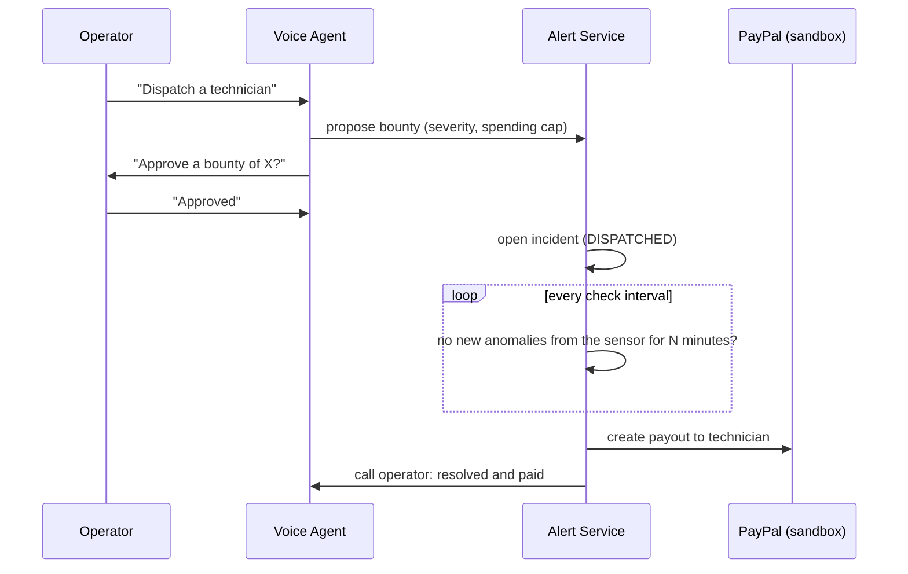

# HydroWatch

**AI incident response for water quality monitoring.** HydroWatch detects anomalies in live sensor data (pH, temperature, dissolved oxygen), stores them, and **phones the on-duty operator**. On the call, the operator can ask for live readings, alert history and procedures grounded in SOP documents, and acknowledge the alert by voice.


## The problem

Operators at water treatment plants and river monitoring sites are not always watching a dashboard. A missed alert about low oxygen or a pH spike can mean a delayed response. A dashboard notification is easy to miss, and a phone call is not.

## What it does

1. Sensors publish pH, temperature and oxygen readings to a Redis stream.
2. An anomaly detector compares each reading against thresholds and publishes anomalies.
3. The alert service pushes each anomaly to the live dashboard, **stores it in PostgreSQL**, and **places a voice call** to the operator (rate-limited, see below).
4. The voice agent tells the operator what happened and how often, and answers follow-up questions using live data and SOP documents.
5. If nobody acknowledges, the system **escalates** to a second contact.

---

## Project status

| Area | Status |
|---|---|
| Sensor data collector, anomaly detector, real-time alert service | Built |
| Redis Streams pipeline and live dashboard (WebSocket) | Built |
| PostgreSQL alert storage | Built |
| RAG assistant on the dashboard (Spring AI, SOP documents) | Built |
| Outbound voice call to the operator (Bolna) | Built |
| Call throttling (cooldown window, hourly cap) | Built |
| In-call tools: live readings, alert status, acknowledge, SOP lookup | Built |
| Escalation call to a second contact | Built |
| Hindi / Hinglish voice support | Built |
| PayPal Responder (technician dispatch and payout) | In development  |

---

## Architecture



**Services** (each Dockerised, one folder per service):

| Service | Role |
|---|---|
| `sensor-data-collector` | Produces sensor readings into `water_quality_stream` |
| `data-anomaly-detector` | Reads readings, applies thresholds, publishes to `anomalies_stream` |
| `real-time-alert` | Pushes alerts to the dashboard, stores them, places and throttles calls, escalates, exposes the voice-tool API and the RAG chat endpoint |
| shared model module | `Anomaly`, `SensorData`, `SensorType`, `RedisStreams` |

**Detection thresholds**

| Parameter | Normal range |
|---|---|
| Temperature | 10 to 20 °C |
| pH | 6.0 to 8.2 |
| Dissolved oxygen | 4.0 to 10.0 |

A single out-of-range reading produces an anomaly. Detection is threshold-based; trend-based and cross-parameter detection are on the roadmap.

---

## Voice agent

Calls are placed through the [Bolna](https://www.bolna.ai) API. Bolna handles speech, telephony and the conversation; this project supplies the trigger, the context, and the tools.

**Context passed to each call:** sensor ID, location, alert reason, time, number of alerts in the current window, and a note stating whether this is the primary or the escalation call.

**Tools the agent can call during a call** (served by `real-time-alert` under `/api/tools/`, protected by a bearer key):

| Tool | Endpoint | Purpose |
|---|---|---|
| `get_alert_status` | `GET /api/tools/alerts/status` | Recent alerts and alert counts per sensor |
| `get_latest_readings` | `GET /api/tools/readings/latest` | Latest value per sensor and parameter |
| `acknowledge_alerts` | `POST /api/tools/alerts/acknowledge` | Marks open alerts as acknowledged (stops escalation) |
| `get_sop_guidance` | `POST /api/tools/sop` | Answers procedure questions from SOP documents via the RAG assistant |

**Call safety:** a cooldown window prevents repeated calls, an hourly cap limits total calls, stale alerts never trigger calls, and calls are disabled unless explicitly enabled.

---

## RAG assistant

- Spring AI `ChatClient` with a `QuestionAnswerAdvisor`.
- SOP documents (`resources/docs/*.txt`) are split with a token splitter, embedded, and held in an in-memory vector store; the top 3 chunks are added to each prompt.
- The assistant answers only from the provided documents and says so when they do not contain the answer.
- Endpoint: `POST /api/chat` with `{"question": "..."}`. The same assistant powers the SOP tool in the voice agent.
- Current Model Support: **Meta** And **Gemini** via Spring AI. See the Meta hackathon section for the Meta model integration.

---

## Tech stack

Java, Spring Boot, Spring AI, Redis Streams, WebSockets (STOMP), PostgreSQL with Spring Data JPA, Docker Compose, Bolna (voice), ngrok.

---

## Getting started

### Prerequisites

Docker and Docker Compose, JDK 17+, Maven, a Bolna account and agent, an ngrok account (for the voice tools).

### 1. Configure environment

Create a `.env` file next to `docker-compose.yml`. Never commit it.

| Variable | Purpose |
|---|---|
| `DB_PASSWORD` | PostgreSQL password |
| `GEMINI_API_KEY` | LLM key for the RAG assistant |
| `META_API_KEY` | LLM key for the RAG assistant |
| `BOLNA_API_KEY`, `BOLNA_AGENT_ID` | Bolna credentials |
| `BOLNA_OPERATOR_PHONE` | Primary operator, E.164 format (`+91...`) |
| `BOLNA_ESCALATION_PHONE` | Second contact (empty disables escalation) |
| `BOLNA_ENABLED` | `true` to place real calls (default `false`) |
| `BOLNA_BYPASS_GUARDRAILS` | Lets urgent alert calls ignore Bolna's calling-hours window |
| `TOOLS_API_KEY` | Secret protecting `/api/tools/**` |
| `ALERT_COOLDOWN_SECONDS` | Minimum gap between calls (default 600) |
| `ALERT_ESCALATION_SECONDS` | Wait before escalating (must be lower than the cooldown) |
| `ALERT_MAX_CALLS_PER_HOUR` | Hourly call cap (default 2) |

### 2. Build and run

```bash
mvn package -DskipTests        # build the jars (the Dockerfiles copy target/*.jar)
docker compose up -d --build --force-recreate
```

The alert service listens on port 8080. PostgreSQL data persists in the `pgdata` volume; the `alerts` table is created automatically.

### 3. Connect the voice agent

1. Run `ngrok http 8080` and note the HTTPS URL.
2. In the Bolna dashboard, create an agent and paste the prompt from `docs/` ([TODO: add prompt file]).
3. Add the four tools above, using the ngrok URL and `Bearer <TOOLS_API_KEY>`.
4. Set `BOLNA_ENABLED=true`, recreate the alert service, and trigger an abnormal reading.

### Verify

```bash
# alerts are stored
docker compose exec postgres psql -U hydrowatch -d hydrowatch \
  -c "SELECT id, sensor_id, reason, created_at, call_placed_at FROM alerts ORDER BY id DESC LIMIT 5;"

# tool API is protected (401 without the key, JSON with it)
curl -H "Authorization: Bearer $TOOLS_API_KEY" http://localhost:8080/api/tools/alerts/status
```

---

## PayPal Responder (in development)

> **Status: in development for the PayPal AI Hackathon.** This README will be updated as each step is completed and tested.

**Idea:** the voice agent can dispatch a technician and **pay them through PayPal only after the sensors confirm the problem is fixed**. Sensor data is the proof of work, and a human approves the spend by voice.



**Planned components**

- `Incident` and `Technician` entities (status: DISPATCHED, RESOLVED, PAID).
- `PayPalPayoutService` calling the PayPal Payouts API in the sandbox.
- A `dispatch_technician` voice tool with a spoken-approval step.
- A scheduled resolution check based on the alerts table.
- Guardrails: a cap per incident and per day, an idempotency key on every payout, and an audit log.

**Progress**

- [ ] PayPal sandbox business and technician accounts created
- [ ] Test payout sent from the backend
- [ ] Incident and technician storage
- [ ] Dispatch tool with voice approval
- [ ] Resolution check and automatic payout
- [ ] Guardrails and audit log

**Configuration (planned):** `PAYPAL_CLIENT_ID`, `PAYPAL_CLIENT_SECRET`, `PAYPAL_MODE=sandbox`. Only sandbox credentials are used; no real money moves.

---

## Limitations

- Sensor data is simulated. Real or replayed data is on the roadmap.
- Each `sensorId` is assumed to measure one parameter.
- The vector store is in memory and rebuilt on every start.
- Calls depend on the Bolna platform and its account, calling-hours and credit settings.

## Roadmap

Trend-based alerts, cross-parameter root-cause reasoning, replay of public water-quality data, Hindi/Hinglish voice, SMS or WhatsApp fallback, automated tests, and the PayPal Responder flow above.

## Security

- Secrets live in `.env` and are never committed.
- Tool endpoints require a bearer key and are exposed publicly only while ngrok is running.
- `BOLNA_BYPASS_GUARDRAILS` is intended only for urgent alert calls to consenting operators.
